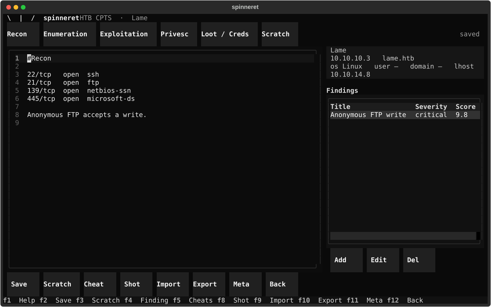

# spinneret

Terminal notes for a penetration test. Open a box, keep phase notes and screenshots next to the target, score findings with CVSS 3.1, and export a report when the lab is done.



spinneret is a keyboard-driven [Textual](https://textual.textualize.io/) app. Notes are Markdown and YAML in a folder you can grep and commit. The cheat sheet copies commands to the clipboard for you to run in your own shell.

## Features

- Engagements and boxes, each with an IP, hostnames, and the other fields the cheat sheet can fill in
- Phase notes: recon, enumeration, exploitation, privesc, loot, and a timestamped scratch log
- Screenshots captured with whatever tool is installed, or imported from a file or the clipboard, then linked into the open note
- Findings with a CVSS 3.1 vector, a computed base score, evidence, and remediation
- A built-in command sheet with fuzzy search and `<IP>`-style placeholders, plus your own YAML overlay
- Markdown and PDF export: executive summary, findings sorted by severity, per-host notes, embedded screenshots

## Install

Python 3.11 or newer. [pipx](https://pipx.pypa.io/) keeps the app in its own environment:

```bash
pipx install .
spinneret
```

On Kali:

```bash
sudo apt install pipx
pipx ensurepath
pipx install .
spinneret
```

A custom data directory:

```bash
spinneret --root ~/labs
# or
export SPINNERET_ROOT=~/labs
spinneret
```

`spinneret --version` prints the version. `python -m spinneret` works too.

### Screenshot tools

Capture uses the first tool it finds, in this order: flameshot, scrot, gnome-screenshot, maim, grim. flameshot, scrot, gnome-screenshot, and maim grab a region. grim uses `slurp` for a region when `slurp` is installed, and otherwise grabs the full output.

```bash
sudo apt install flameshot
```

Clipboard import reads a PNG through `wl-paste` (package `wl-clipboard`) or `xclip`. Copy to the clipboard uses Textual's terminal clipboard plus `wl-copy`, `xclip`, or `xsel` when one of those is installed.

Shot names the packages to install when none of those tools are on `PATH`. Import still accepts a png, jpg, gif, or webp from disk.

### PDF

PDF export uses [fpdf2](https://pypi.org/project/fpdf2/), which is pure Python. No Cairo, Pango, or Pandoc install is required.

Unicode in the PDF uses DejaVu Sans when that font is installed (`sudo apt install fonts-dejavu-core`, already common on Kali and Ubuntu). Otherwise the PDF uses the built-in Helvetica font and replaces characters outside Latin-1.

## Usage

```text
spinneret
```

1. `n` creates an engagement. Enter opens it.
2. `n` creates a box. Set the IP and hostnames. `lhost` is your attacking address (often `tun0`) so transfer commands can fill `<LHOST>`.
3. Enter opens the workspace. The note editor is focused. Switch phases with the buttons or `alt+1` through `alt+6`.
4. `F3` appends a timestamped line to the scratch log.
5. `F4` adds a finding. Paste a `CVSS:3.1/...` vector or set the metric selectors. The base score updates as you type.
6. `F5` opens the cheat sheet. Type to filter, Enter copies the command with this box's IP and hostnames filled in.
7. `F8` captures a screenshot into the box folder and links it in the current note. `F9` imports a file or the clipboard.
8. `F10` writes `report.md` and `report.pdf` in the engagement folder.

`s` on the box list edits the executive summary (`summary.md`). An empty summary leaves the placeholder section in the report.

Export from the shell, using the engagement's folder slug:

```bash
spinneret export htb-cpts
spinneret export htb-cpts --markdown ~/out/report.md --pdf ~/out/report.pdf
spinneret export htb-cpts --no-pdf
```

## Keybindings

`F1` opens the same list inside the app. `ctrl+q` quits from any screen.

| Key | Where | Action |
| --- | --- | --- |
| `n` | Engagements | New engagement |
| `enter` / `o` | Engagements, boxes | Open |
| `e` | Engagements, boxes | Edit |
| `d` | Engagements, boxes | Delete |
| `q` | Engagements | Quit |
| `s` | Boxes | Executive summary |
| `x` | Boxes | Export |
| `escape` | Boxes, dialogs | Back or cancel |
| `alt+1` … `alt+6` | Workspace | Recon, enumeration, exploitation, privesc, loot, scratch |
| `F2` / `ctrl+s` | Workspace | Save the note (also saves on phase change, and every few seconds) |
| `F3` | Workspace | Append a timestamped scratch line |
| `F4` | Workspace | Add a finding. On the findings list, edit the selected row |
| `F5` | Workspace | Cheat sheet |
| `F8` | Workspace | Capture a screenshot into the current note |
| `F9` | Workspace | Import an image |
| `F10` | Workspace | Export the report |
| `F11` | Workspace | Edit this box |
| `F12` | Workspace | Back |
| type, then `enter` | Cheat sheet | Filter, then copy the best match |

Letters typed into the note editor go into the note. The function keys and `alt+1` through `alt+6` still run the actions above.

## Data layout

Everything lives under `~/spinneret` unless you pass `--root` or set `SPINNERET_ROOT`.

```text
~/spinneret/
  htb-cpts/
    engagement.yaml
    summary.md
    report.md              # written by export
    report.pdf
    lame/
      box.yaml             # ip, hostnames, os, user, domain, lhost
      notes/
        recon.md
        enumeration.md
        exploitation.md
        privesc.md
        loot.md
        scratch.md
      findings/
        F-001.yaml
      screenshots/
        shot-20261120T214402Z.png
```

Slugs are lowercase directory names. Two engagements with the same display name become `lab` and `lab-2`. Finding ids (`F-001`, `F-002`, …) are unique across the engagement. Image links inside a note are relative (`../screenshots/shot-….png`), so the note still works in a normal Markdown viewer.

A finding file stores the canonical vector, the base score, and the severity. On load, the score is computed again from the vector.

## Cheat sheet

The built-in sheet covers service scans, full TCP and top UDP, DNS (`dig axfr`), whatweb, curl, gobuster and ffuf for directories and vhosts, SMB and NFS listing, and file transfer with `wget`, `curl`, `certutil`, PowerShell `Invoke-WebRequest`, and base64. Wordlist paths match a default Kali layout. Edit them in your overlay if yours differ.

Placeholders filled from the open box when that field is set:

| Token | Source |
| --- | --- |
| `<IP>` | Box IP |
| `<HOST>`, `<HOSTNAME>` | First hostname, or the IP / box name |
| `<DOMAIN>` | Domain, or the hostname when it contains a dot |
| `<USER>` | User |
| `<BOX>` | Box name |
| `<LHOST>` | LHOST |
| `<OS>` | OS |

`<FILE>`, `<SHARE>`, and anything else you have not set stay in the command so you can see what to replace.

Add or replace entries by id. A later file wins.

```yaml
# ~/.config/spinneret/cheatsheet.yaml
# also read: ~/spinneret/cheatsheet.yaml
entries:
  - id: nmap-service
    title: Quiet service scan
    category: Nmap
    command: nmap -sV -T2 <IP>
  - id: my-alias
    title: Tunnel check
    category: Notes
    command: ip -4 addr show tun0
```

## CVSS

Base scoring follows the FIRST CVSS v3.1 equation (specification section 7.1). Arithmetic uses `Decimal`, and the one-decimal round-up is the ceiling from section 7, which avoids the binary-float trap in Appendix A. Temporal and environmental metrics may be present on a pasted NVD vector. They are checked and ignored. The rating bands are the specification section 6 bands: None, Low, Medium, High, Critical.

`CVSS:3.1/AV:N/AC:L/PR:N/UI:N/S:U/C:H/I:H/A:H` scores 9.8. Tests cover published vectors, metric order, rejected strings, and the round-up examples (4.02 → 4.1, 4.00 → 4.0).

## Development

```bash
python -m venv .venv
source .venv/bin/activate
pip install -e ".[dev]"
ruff check src tests
ruff format --check src tests
pytest
```

GitHub Actions runs that lint and `pytest` on Python 3.11, 3.12, 3.13, and 3.14.

Regenerate the README image from a seeded workspace:

```bash
python scripts/export_screenshot.py
```

## Roadmap

- Search across notes in an engagement
- CVSS temporal and environmental scores
- Import an Nmap XML file into the recon note
- HTML report alongside Markdown and PDF
- A library of finding templates
- A short git helper for pushing an engagement folder

## License

[MIT](LICENSE). Copyright (c) 2026 Brandon.
